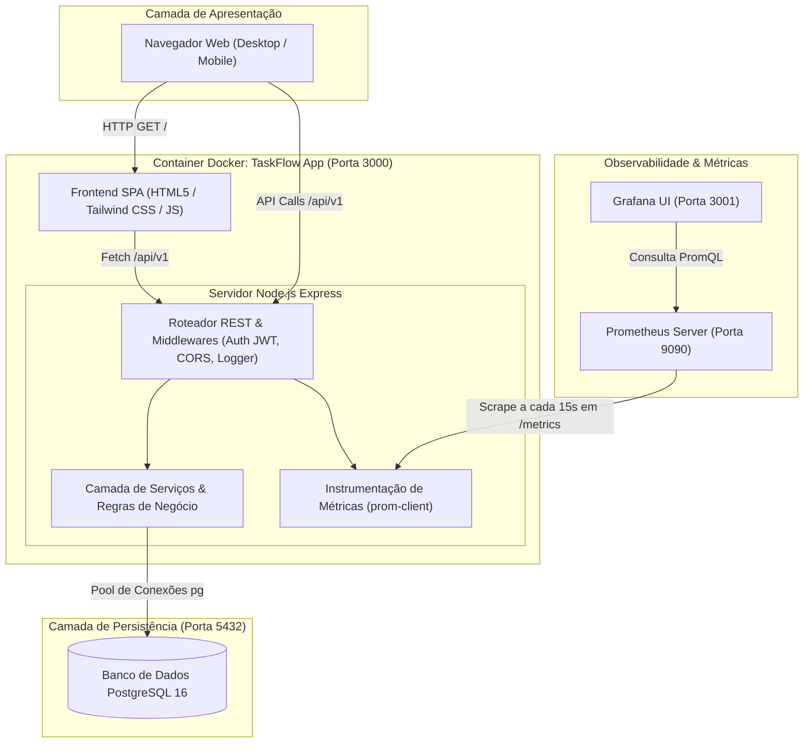

# 🚀 TaskFlow — Sistema de Gerenciamento de Tarefas & Pipeline DevOps

[](https://github.com/IgorFreitasf/taskflow-devops/actions/workflows/pipeline.yml)
[](https://github.com/IgorFreitasf/taskflow-devops)
[](https://github.com/IgorFreitasf/taskflow-devops)
[](https://nodejs.org/)
[](https://www.postgresql.org/)
[](https://prometheus.io/)

> 💡 **Nota sobre o Badge de CI:** Para que o badge acima reflita o status do seu repositório em tempo real, substitua `IgorFreitasf` pelo seu usuário ou organização no GitHub.

Sistema web completo desenvolvido para simular o ecossistema de engenharia de software de uma startup moderna: arquitetura desacoplada em serviços, planejamento ágil com SCRUM, esteira de CI/CD rigorosa com GitHub Actions, containerização Docker multi-stage e observabilidade operacional com métricas RED (Prometheus e Grafana).

---

## 🌐 Acesso ao Projeto

A aplicação TaskFlow está publicada e pode ser acessada diretamente pelo navegador, sem necessidade de instalação.

| Recurso | Link |
|---|---|
| 🚀 Aplicação online | https://taskflow-devops-sdzi.onrender.com |
| 💻 Repositório GitHub | https://github.com/IgorFreitasf/taskflow-devops |
| ❤️ Health Check | https://taskflow-devops-sdzi.onrender.com/health |
| 📊 Métricas Prometheus | https://taskflow-devops-sdzi.onrender.com/metrics |

### Como acessar

1. Acesse o link da aplicação online.
2. Crie uma conta ou entre com suas credenciais.
3. Comece a cadastrar e gerenciar suas tarefas.

**Tecnologias utilizadas:** Node.js, Express, PostgreSQL, Docker, GitHub Actions, Prometheus e Grafana.

## 🏛️ 1. Arquitetura do Sistema e Topologia



---

## 🔄 2. Fluxo do Pipeline Unificado CI/CD

```mermaid
flowchart LR
    Dev["Desenvolvedor"] -->|git push| FeatureBranch["Branch feature/*"]
    FeatureBranch -->|Abre Pull Request| PR["Pull Request -> main"]

    subgraph CI["1. Job CI: build-and-test"]
        ESLintStep["ESLint (Validação Estática)"]
        UnitTests["Testes Unitários"]
        IntegTests["Testes Integração (Postgres 16 Service)"]
        CoverageCheck["Checagem de Cobertura (Min 70%)"]

        ESLintStep --> UnitTests
        UnitTests --> IntegTests
        IntegTests --> CoverageCheck
    end

    PR -->|Dispara CI| CI
    CoverageCheck -->|Merge Aprovado na main| MainBranch["Branch main"]

    subgraph CD["2. Job CD: deploy-production"]
        DeployHook["Disparo do Deploy Hook (Render / Cloud)"]
        WaitTime["Aguardar inicialização do container (45s)"]
        SmokeTest["Smoke Test Automatizado (GET /health)"]

        DeployHook --> WaitTime
        WaitTime --> SmokeTest
    end

    MainBranch -->|needs: build-and-test| CD
    SmokeTest -->|HTTP 200 UP| ProductionReady["Produção Estável"]
```



---

## ⚙️ 3. Pré-requisitos
* [Docker](https://www.docker.com/) e Docker Compose instalados **OU**
* [Node.js](https://nodejs.org/) versão 20 LTS ou superior.

---

## 🐳 4. Como Executar Localmente com Docker Compose
Para subir todo o ecossistema (App + Banco PostgreSQL + Prometheus + Grafana) com um único comando:

```bash
docker compose up --build -d
```

Acessos locais:
* **Aplicação Web (SPA):** [http://localhost:3000](http://localhost:3000)
* **Endpoint de Saúde (/health):** [http://localhost:3000/health](http://localhost:3000/health)
* **Métricas Prometheus (/metrics):** [http://localhost:3000/metrics](http://localhost:3000/metrics)
* **Servidor Prometheus:** [http://localhost:9090](http://localhost:9090)
* **Dashboards Grafana:** [http://localhost:3001](http://localhost:3001) *(login: `admin` / senha: `admin`)*

Para encerrar os serviços:
```bash
docker compose down -v
```

---

## 💻 5. Como Executar com Node.js Nativo
1. Instale as dependências:
   ```bash
   npm install
   ```
2. Crie o arquivo `.env` baseado no exemplo:
   ```bash
   cp .env.example .env
   ```
3. Execute o linting estático com ESLint:
   ```bash
   npm run lint
   ```
4. Inicie o servidor:
   ```bash
   npm run dev
   ```

---

## 🧪 6. Como Rodar a Suíte de Testes e Cobertura
O projeto conta com mais de 20 testes unitários e de integração com cobertura rigorosa:

```bash
# Executa todos os testes
npm test

# Executa os testes gerando relatório e forçando limiar de cobertura >= 70%
npm run test:coverage
```

---

## 🔑 7. Variáveis de Ambiente

| Variável | Descrição | Exemplo Padrão |
| :--- | :--- | :--- |
| `PORT` | Porta HTTP da aplicação | `3000` |
| `NODE_ENV` | Ambiente de execução | `development`, `test`, `production` |
| `JWT_SECRET` | Chave criptográfica do JWT | `super_segredo_jwt_taskflow` |
| `DATABASE_URL`| String de conexão PostgreSQL | `postgresql://postgres:postgres_password@db:5432/taskflow_db` |
| `CORS_ORIGIN` | Origens permitidas para requisições cross-origin | `*` ou `https://meuapp.com` |
| `LOG_LEVEL` | Nível mínimo de logs do Winston | `info` |

---

## 🌐 8. Endpoints Principais da API

* `GET /health`: Health check com diagnóstico de conectividade do banco de dados e latência.
* `GET /metrics`: Métricas no formato padrão do Prometheus.
* `POST /api/v1/auth/register`: Cadastro de usuário.
* `POST /api/v1/auth/login`: Autenticação e obtenção do token JWT.
* `GET /api/v1/auth/me`: Retorna dados do usuário autenticado.
* `GET /api/v1/tasks`: Listagem de tarefas do usuário logado (filtros: `?status=...&priority=...`).
* `POST /api/v1/tasks`: Criação de tarefa.
* `GET /api/v1/tasks/:id`: Busca de tarefa por ID.
* `PUT /api/v1/tasks/:id`: Atualização de tarefa.
* `DELETE /api/v1/tasks/:id`: Remoção de tarefa.
## Acessos ao projeto

- 🌐 [Aplicação TaskFlow](https://taskflow-devops-sdzi.onrender.com)
- 📊 [Grafana Cloud](https://narrowwscone1195.grafana.net)
- 📈 Prometheus — monitoramento de métricas
- 💻 [Código-fonte no GitHub](https://github.com/IgorFreitasf/taskflow-devops)

## Tecnologias utilizadas

- Node.js
- Express
- PostgreSQL
- Docker
- GitHub Actions
- Prometheus
- Grafana
- Render
